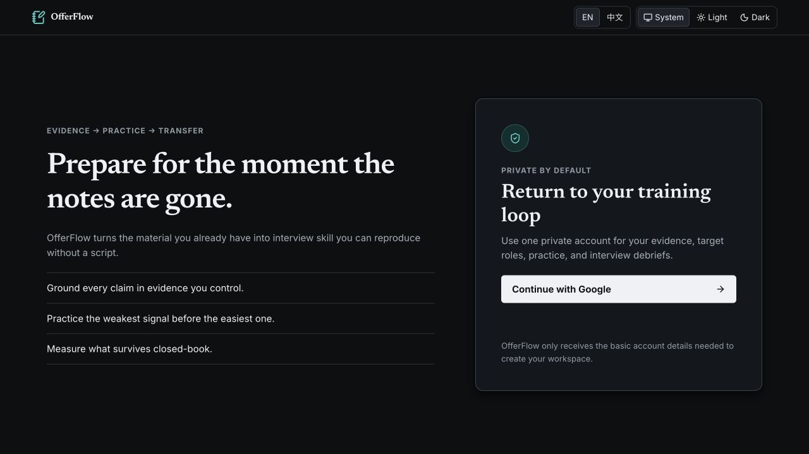
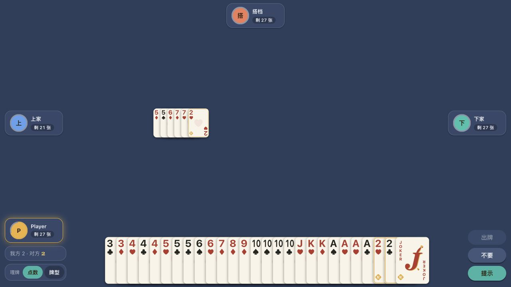
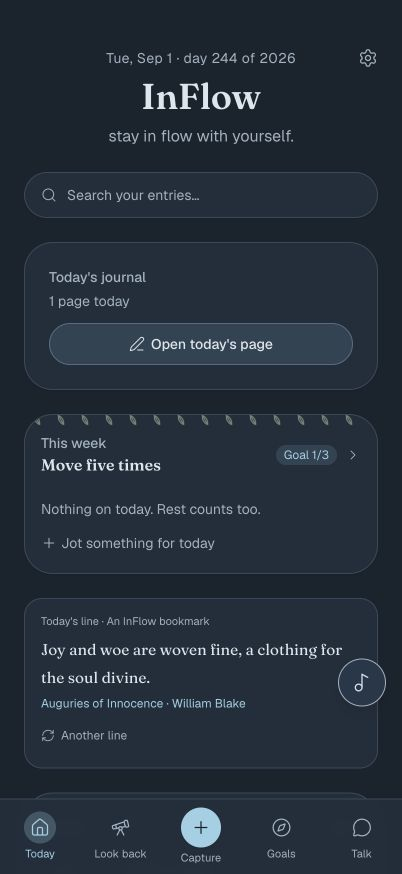

# Boran

Senior Data Scientist building AI systems and products.

My work spans generative AI, agentic systems, retrieval, and applied machine learning. Outside work, I turn ideas into usable products and developer tools.

## Selected Projects

### [OfferFlow ↗](https://offerflow.yvoone.com) [tmp close for public access]

An evidence-grounded interview preparation workspace that connects a candidate's experience to a specific role, then turns that foundation into a repeatable practice loop.

`Generative AI` · `Evidence-grounded workflows` · `Interview practice`

### [Guandan ↗](https://guandan.yvoone.com)

Online multiplayer Guandan with an AI opponent trained through reinforcement learning.

`Reinforcement learning` · `Game AI` · `Multiplayer systems`

### [InFlow ↗](https://inflow.yvoone.com)

An AI-assisted, mobile-first PWA for daily reflection, personal goals, and looking back over time.

`Applied AI` · `Mobile-first PWA` · `Local-first data`

## Developer Tool

### [Claude Code Dev Tools ↗](https://marketplace.visualstudio.com/items?itemName=yedewww.claude-code-dev-tools)

A VS Code toolkit for Claude Code with real-time usage and cost tracking, a multi-account pool with threshold-based switching, and scheduled usage-window warm-ups.

`Developer tooling` · `VS Code extension` · `800+ installs`

## A few other projects are working in progress

## Areas I Work In

- Generative AI and agentic systems
- Retrieval, knowledge systems, and AI architecture
- Machine learning, reinforcement learning, and applied algorithms
