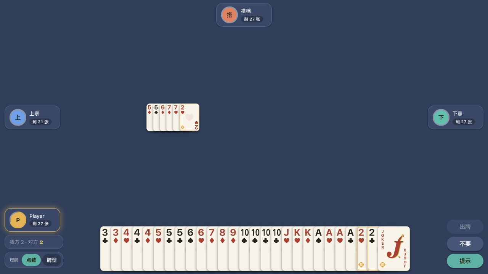
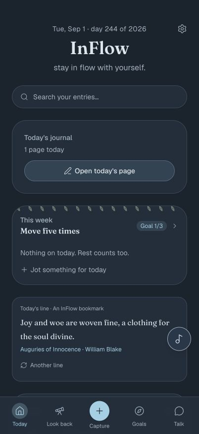
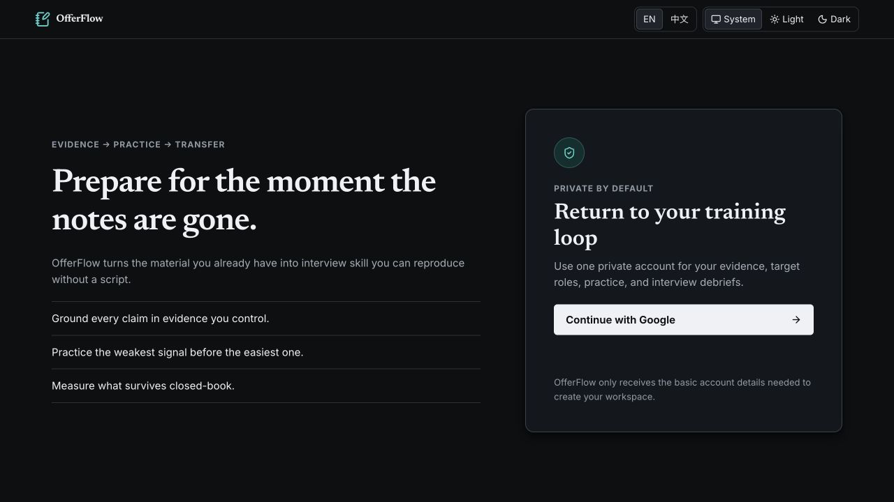

# Hi, I'm Boran 👋

Senior Data Scientist in Singapore building agentic AI and LLM systems. Most of what I build starts from nothing and ends up in production.

🔒 My day job is closed source, so this page is mostly about what I build in my own time. The projects below are live and you can try most of them right now.

📫 [LinkedIn](https://www.linkedin.com/in/boran-yang/)

## 🚀 Projects

| | Project | What it is | Link |
|---|---|---|---|
| 🧩 | **Claude Code Dev Tools** | VS Code toolkit for Claude Code, 900+ installs | [Marketplace](https://marketplace.visualstudio.com/items?itemName=yedewww.claude-code-dev-tools) |
| 🃏 | **Guandan** | Multiplayer card game with an RL-trained AI opponent | [Play](https://guandan.yvoone.com) |
| 📝 | **InFlow** | AI-assisted app for daily reflection and goals | [Open](https://inflow.yvoone.com) (best on mobile) |
| 🎯 | **OfferFlow** | Evidence-grounded interview prep workspace | [Visit](https://offerflow.yvoone.com) (registration closed) |

### 🧩 Claude Code Dev Tools

A VS Code toolkit for Claude Code. It tracks usage and cost in real time, manages a multi-account pool with threshold-based switching, and schedules usage-window warm-ups.

📈 900+ installs, all organic.

**[Get it on the VS Code Marketplace →](https://marketplace.visualstudio.com/items?itemName=yedewww.claude-code-dev-tools)**

`Developer tooling` `VS Code extension`

---

### 🃏 Guandan

Online multiplayer Guandan, a four-player Chinese card game, with an AI opponent trained through reinforcement learning. I trained the model on my own GPU. Available in English and Chinese.

**[Play it →](https://guandan.yvoone.com)**

`Reinforcement learning` `Game AI` `Multiplayer systems`

---

### 📝 InFlow

An AI-assisted, mobile-first PWA for daily reflection, personal goals, and reviewing progress over time. Data is stored local-first.

📱 Best opened in a mobile browser.

**[Open it →](https://inflow.yvoone.com)**

`Applied AI` `Mobile-first PWA` `Local-first data`

---

### 🎯 OfferFlow

An evidence-grounded interview prep workspace. It matches a candidate's experience to a specific role and supports a repeatable practice loop.

🚧 Registration is currently closed.

**[Visit →](https://offerflow.yvoone.com)**

`Generative AI` `Evidence-grounded workflows`

---

More projects are in development.

## 🛠️ What I work on

- 🤖 **Agents**: multi-agent and multi-step workflows with LangGraph and MCP
- 🔍 **Retrieval and knowledge**: agentic RAG, multimodal RAG, GraphRAG
- 📊 **Evaluation and reliability**: LLM evaluation, observability, structured outputs, prompt caching
- ☁️ **Production engineering**: cloud-native microservices on Azure, Docker, Kubernetes, CI/CD

Before LLMs I worked in classical machine learning and deep learning, mainly NLP, computer vision, and anomaly detection. Some of the older repositories here are from that time.

## 🧰 Tech stack

**AI and agents**

**Machine learning**

**Data and retrieval**

**Cloud and engineering**

## 🎓 Background

- Master of Computing in Artificial Intelligence, National University of Singapore
- Bachelor of Advanced Computing (Honours), Australian National University
- First-author paper on real-time object detection and domain adaptation, selected for oral presentation at IEEE IJCNN
